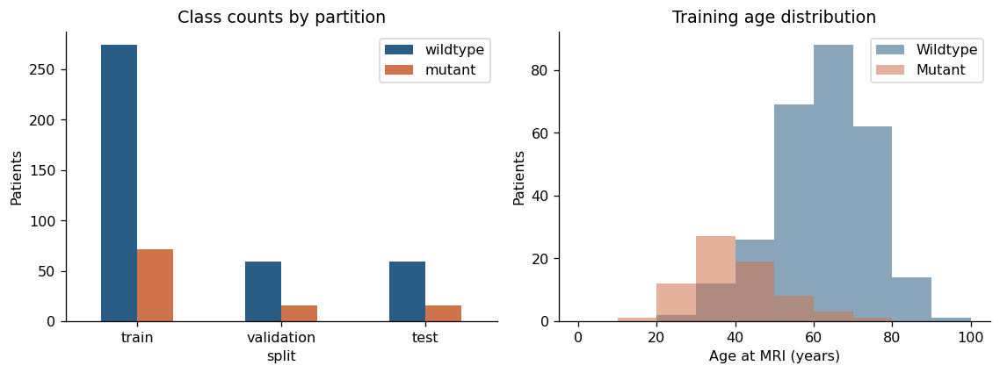
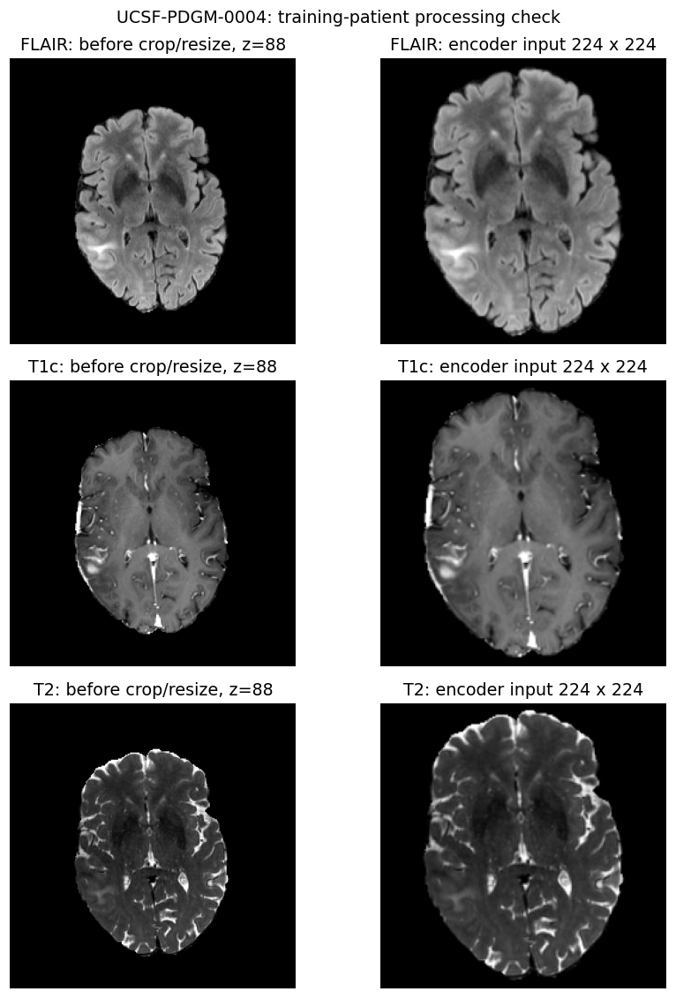
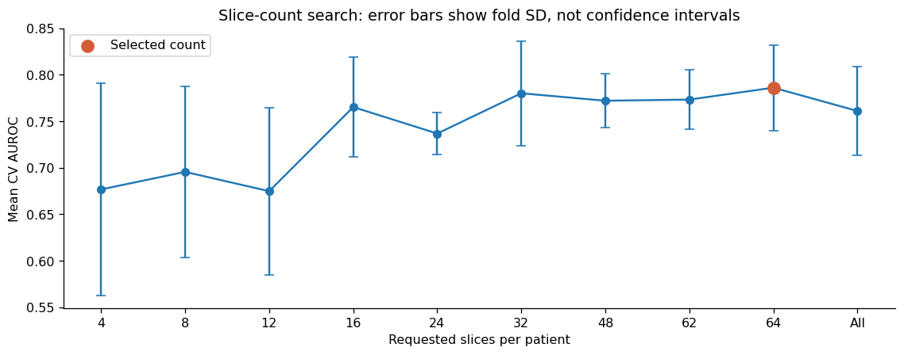
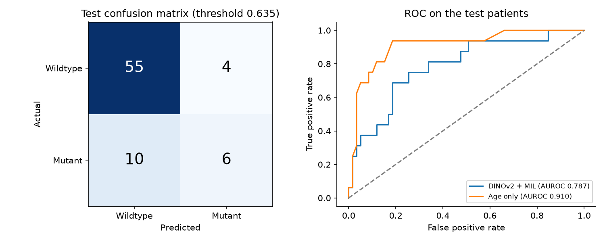

# IDH Mutation Prediction from Brain MRI with Frozen DINOv2

A patient-level classifier that reads three MRI contrasts of a glioma patient (FLAIR, contrast-enhanced T1 and T2) and predicts whether the tumour is **IDH-mutant** or **IDH-wildtype**. A frozen, pretrained [DINOv2](https://arxiv.org/abs/2304.07193) vision transformer encodes individual axial slices, and a small gated-attention head pools the slices into one prediction per patient.

The research question is a narrow one: **how many slices per patient does this setup need?** The slice count is chosen by cross-validation instead of being fixed at 8 or 16 by hand.

The project started as a single Kaggle notebook. This repository is the cleaned-up version: the code is split into a small package with step-by-step scripts and notebooks, the reported numbers come from the actual run, and a few simple improvements were added (see [What changed](#what-changed-from-the-original-notebook)). The modelling approach is the same as in the notebook.

> **Note:** This README was written by Claude (Anthropic's AI assistant), which also helped restructure the original notebook into this repository.

---

## The task

[UCSF-PDGM](https://www.cancerimagingarchive.net/collection/ucsf-pdgm/) (v5) is a public dataset of preoperative MRI from **495 adult diffuse-glioma patients** with molecular labels.

* **Input:** three co-registered, skull-stripped 3-D volumes per patient (FLAIR, T1c, T2), each 240 × 240 × 155 at 1 mm.
* **Output:** one score per patient; IDH wildtype = 0, IDH mutant = 1 (any IDH1/IDH2 variant).
* **Class balance:** 392 wildtype, 103 mutant (21% mutant).
* **Not used as inputs:** age, sex, grade or diagnosis. Labels come from the official metadata CSV. The 6 follow-up examinations are dropped so that each patient appears only once.

| Split | Wildtype | Mutant | Total |
|---|---|---|---|
| Train | 274 | 71 | 345 |
| Validation | 59 | 16 | 75 |
| Test | 59 | 16 | 75 |

The split is stratified and patient-level (seed 2026). The two classes also differ clinically. In the training split, mutant patients are much younger (mean age 40 vs. 62) and mostly grade 2–3, while wildtype tumours are mostly grade 4. Those variables are not model inputs, but they are a strong non-imaging baseline (see [Results](#results)).



## Approach

### 1. Preprocessing (`idh/preprocessing.py`)
Each volume is reoriented to RAS and normalised on its own (the 1st–99th percentile of nonzero voxels is mapped to [0, 1]). The volume is then cropped to the brain. Every nonempty axial slice becomes a 3-channel image (FLAIR, T1c, T2 in place of RGB), letterboxed to 224 × 224 without stretching. No tumour mask is used.



### 2. Frozen DINOv2 features (`idh/features.py`, `extract_features.py`)
DINOv2-small (pinned revision, 22M parameters, **no weights updated**) turns each slice into a 384-d CLS vector. All ~70,000 slices of the 495 patients are encoded once and cached (~200 MB, about 14 min on a Kaggle GPU). Every later step uses only this cache.

### 3. Gated-attention MIL head (`idh/model.py`)
Each patient is a *bag* of slice vectors. The head is a gated-attention pooling layer ([Ilse et al., 2018](https://proceedings.mlr.press/v80/ilse18a.html)): it gives each slice a weight and classifies the weighted average.

```
k slice vectors (k x 384) -> LayerNorm
  -> attention: w^T [tanh(V h) * sigmoid(U h)]  -> softmax over slices    (V, U: 384 -> 128)
  -> weighted sum (384) -> Dropout(0.3) -> Linear(1) -> sigmoid
```

About 100k trainable parameters. Training uses class-weighted BCE, AdamW (lr 1e-3, wd 1e-4), batch size 16 and gradient clipping.

### 4. Choosing the slice count (`idh/selection.py`, `search_slices.py`)
For each candidate k ∈ {4, 8, 12, 16, 24, 32, 64, all}, k evenly spaced slices are taken from the central 90% of the brain. Each candidate is scored by **3-fold patient-level CV on the training split only**. Inside each fold, 20% of the development patients are held out for early stopping (patience 6). Every candidate uses the same folds and seeds. Up to four refinement counts are then tested around the best one. The highest mean AUROC wins, and within a 0.005 tie the smaller k wins.

### 5. Final model, threshold and test (`train.py`, `evaluate.py`)
A fresh head is trained on all 345 training patients for the median early-stopping epoch of the winner. The **validation** patients only choose the decision threshold (maximum balanced accuracy). The **test** patients are scored once with everything locked. The image model is compared with two non-imaging baselines:

* **always wildtype:** shows what plain accuracy has to beat;
* **age only:** logistic regression on age. It is fitted on the training split, and its threshold is chosen on the validation split.

## Results

These are the numbers from the original Kaggle run (GPU, seed 2026). The age-only baseline was computed afterwards with `evaluate.py` on the same split, features and trained head. The raw outputs are in [`results/`](results/).

**Slice-count search** (training patients, 3-fold CV):

| Slices / patient | 4 | 8 | 12 | 16 | 24 | 32 | 48 | 62 | **64** | all (~126) |
|---|---|---|---|---|---|---|---|---|---|---|
| Mean CV AUROC | 0.677 | 0.696 | 0.675 | 0.765 | 0.737 | 0.780 | 0.772 | 0.773 | **0.786** | 0.761 |
| Fold SD | 0.114 | 0.092 | 0.090 | 0.053 | 0.023 | 0.056 | 0.029 | 0.032 | 0.046 | 0.048 |



**Selected: 64 slices**, final training 11 epochs, threshold 0.635.

**Test set** (75 patients, 16 mutant, used once):

| Metric | DINOv2 + attention MIL | Age only | Always wildtype |
|---|---|---|---|
| **AUROC** (95% bootstrap CI) | **0.787** (0.659–0.899) | **0.910** (0.818–0.978) | 0.500 |
| Average precision | 0.545 | 0.719 | 0.213 |
| Accuracy | 0.813 | 0.867 | 0.787 |
| Balanced accuracy | 0.654 | 0.847 | 0.500 |
| Sensitivity (mutant) | 0.375 (6 / 16) | 0.812 (13 / 16) | 0.000 |
| Specificity (wildtype) | 0.932 (55 / 59) | 0.881 (52 / 59) | 1.000 |
| PPV / NPV | 0.600 / 0.846 | 0.650 / 0.945 | – / 0.787 |
| Threshold (from validation) | 0.635 | 0.330 | – |

The validation split, which was used to set the threshold, gave AUROC 0.853 and sensitivity 0.75 (12/16).



**Reading the numbers**

* **The model ranks reasonably:** a test AUROC of 0.79 is clearly above chance, and the frozen encoder was trained only on natural images. The interval is wide (0.66–0.90) because there are only 16 mutant test patients.
* **Accuracy says little here.** 81.3% looks good, but always answering "wildtype" already gives 78.7%.
* **The threshold did not transfer.** It was tuned on 16 validation mutants and found 12 of them, but on the test set it finds only 6 of 16. With so few positives a tuned threshold is fragile. A lower threshold would catch more mutants at the cost of more false alarms.
* **The slice count matters only at the low end.** 4–12 slices are clearly worse, but everything from 16 to "all" lies within about one fold-SD. The choice of 64 over 32 (0.786 vs. 0.780) is a near-tie, not a meaningful win.
* **Age alone does better than the image model.** A one-variable logistic regression on age reaches 0.91 AUROC and finds 13 of 16 mutants, against 0.79 and 6 of 16 for the image model. With only 16 mutant test patients the AUROC intervals overlap, but the direction is clear. IDH-mutant patients are about 20 years younger on average, and in this setup a frozen natural-image encoder plus slice pooling does not capture more than that. This is the most important result of the project. The obvious next steps are to combine age with the image score, and to test whether the image model adds anything once age is known.
* **Re-running on a CPU gives different CV numbers.** The scripts reproduce the original notebook exactly on the same device (checked by running the notebook's own training code on CPU). Dropout random numbers differ between GPU and CPU, though, so a CPU run of `search_slices.py` gives other fold scores (k=4: 0.72 instead of 0.68, k=64: 0.79). It still selects 64 slices, and the test AUROC becomes 0.772. That the ranking moves this much with the dropout masks is more evidence that the slice-count differences are mostly noise.

## What changed from the original notebook

The preprocessing, encoder, head, slice-search procedure, seeds and threshold rule are unchanged. With the same feature cache, the scripts follow the same steps and seeds as the notebook. Applied to the trained head, they reproduce its test predictions exactly, and on the same device they also reproduce its training.

1. **Structure.** The ~1,400-line notebook is split into an `idh/` package, five step scripts and two short notebooks. Kaggle-specific global flags (`RUN_EXTRACTION`, `RUN_SEARCH`, …) and paths were removed.
2. **Less bookkeeping.** The notebook checksummed and locked every intermediate file (per-fold checkpoints, identity JSONs, completion markers). Fitting the head takes seconds, so this is now plain in-memory training. Only the expensive step, feature extraction, is still cached and resumable.
3. **Age-only baseline (new).** `evaluate.py` reports a logistic-regression-on-age baseline under the same train/validation protocol as the image model, plus its ROC curve. It turned out to beat the image model (see [Results](#results)).
4. **Repeated CV option (new).** `search_slices.py --cv-folds 5 --cv-repeats 3` averages the slice-count search over reshuffled folds. The default (3 folds, 1 repeat) reproduces the reported run.
5. **Inference (new).** `predict.py` and `idh.inference.IDHPredictor` run the whole pipeline on a new patient's NIfTI files, and also return the attention weight of each slice.
6. **Reusing the Kaggle run (new).** `import_kaggle_run.py` converts the notebook's exported archive into `model/` (trained head + config) and `features/` (feature cache). Everything after feature extraction can then be re-run on a CPU without downloading the MRI.
7. **Honest reporting.** The notebook's introduction quoted "approximately 0.79 AUROC and 0.81 accuracy" from memory. The README now reports the measured values together with the baseline, sensitivity and confidence interval.

The original notebook is kept unchanged, with its outputs, in [`notebooks/archive/IDH_original_kaggle.ipynb`](notebooks/archive/IDH_original_kaggle.ipynb).

## Known limitations

* **Small test set:** 16 mutant test patients, so every test metric has a wide interval.
* **The test set has been looked at.** Test results from earlier versions of this project informed later design decisions, so the test numbers are exploratory rather than a clean hold-out estimate.
* **Single site:** all data is from UCSF. There is no external validation.
* **Natural-image encoder:** DINOv2 was pretrained on photographs, and the MRI contrasts are fed in as RGB channels. Freezing it makes the pipeline cheap but limits adaptation to MRI.
* **No 3-D context:** the head pools a *set* of slices and does not know their order or position.
* **Threshold and calibration:** the threshold comes from 75 patients, and the scores are not calibrated probabilities (see `results/pr_reliability_test.png`).
* **Confounding:** age and grade are not inputs, but the images carry information about both (e.g. enhancement and necrosis in grade-4 tumours). The model may partly be learning grade rather than IDH status.

## Try the model

> ⚠️ Research code, **not a medical device**. Do not use its output for any clinical decision.

The trained head from the Kaggle run (`model/head.pt`, ~400 KB) and its settings (`model/config.json`: 64 slices, threshold 0.635) are included. Predict on any patient with co-registered, skull-stripped FLAIR / T1c / T2 volumes:

```bash
python predict.py --flair flair.nii.gz --t1c t1c.nii.gz --t2 t2.nii.gz
python predict.py --patient-dir data/mri/UCSF-PDGM-0021
```

```python
from idh.inference import IDHPredictor

predictor = IDHPredictor("model")
result = predictor.predict({"FLAIR": "flair.nii.gz", "T1c": "t1c.nii.gz", "T2": "t2.nii.gz"})
print(result["predicted_class"], round(result["score"], 3))
```

The first prediction downloads DINOv2-small (~90 MB) from Hugging Face. A CPU is enough for single patients. As a check, `predict.py` on UCSF-PDGM-0021 (a validation patient) gives a score of 0.971, the same as the original notebook.

To re-run the analysis without the MRI, take the archive saved by the Kaggle notebook (`idh_dinov2_auto_slices_v1.zip`, ~220 MB, in the notebook's *Output* tab). `python import_kaggle_run.py idh_dinov2_auto_slices_v1.zip --features` unpacks its feature cache into `features/`.

## Repository structure

```
├── idh/                          # importable package
│   ├── config.py                 # experiment settings (defaults = reported run)
│   ├── data.py                   # labels, follow-up handling, image indexing, patient split
│   ├── preprocessing.py          # NIfTI -> normalised, cropped, letterboxed 3-channel slices
│   ├── features.py               # frozen DINOv2, feature cache, slice sampling
│   ├── model.py                  # gated-attention MIL head
│   ├── training.py               # fitting, early stopping, checkpoint I/O
│   ├── selection.py              # cross-validated slice-count search
│   ├── metrics.py                # metrics, threshold, bootstrap / Wilson intervals, age baseline
│   ├── plots.py
│   └── inference.py              # IDHPredictor: run the trained pipeline on a new patient
├── prepare_data.py               # step 1: download MRI + labels -> data/cohort.csv
├── extract_features.py           # step 2: DINOv2 features for every slice -> features/   (GPU)
├── search_slices.py              # step 3: CV slice-count search -> results/
├── train.py                      # step 4: final head + validation threshold -> model/
├── evaluate.py                   # step 5: test metrics and baselines -> results/
├── predict.py                    # CLI: predict one patient
├── import_kaggle_run.py          # use the original Kaggle run's weights and features
├── model/                        # trained head (head.pt) + settings and threshold (config.json)
├── results/                      # metrics, predictions and figures of the reported run
├── notebooks/
│   ├── 01_data_exploration.ipynb
│   ├── 02_slice_search_and_evaluation.ipynb
│   └── archive/IDH_original_kaggle.ipynb
├── requirements.txt
└── README.md
```

## How to run

```bash
pip install -r requirements.txt      # install a CUDA build of PyTorch first if you have a GPU

python prepare_data.py --data-dir data          # ~4.6 GB MRI subset from Hugging Face + official labels
python extract_features.py --out-dir features   # GPU, ~15 min; resumable
python search_slices.py                         # CPU is fine from here on
python train.py
python evaluate.py
```

All scripts take `--help`. If you already have the Kaggle archive, skip the first two steps with `python import_kaggle_run.py <zip> --features`. On Kaggle, enable Internet and a GPU, clone the repo and run the same commands. Set `HF_TOKEN` if Hugging Face rate-limits anonymous downloads.

## Acknowledgements

* Calabrese, E., Villanueva-Meyer, J. E., Rudie, J. D., et al. *The University of California San Francisco Preoperative Diffuse Glioma MRI Dataset.* Radiology: Artificial Intelligence 4(6), e220058 (2022). Data from [The Cancer Imaging Archive](https://www.cancerimagingarchive.net/collection/ucsf-pdgm/) (CC BY 4.0); images via the [MedOtter/UCSF-PDGM](https://huggingface.co/datasets/MedOtter/UCSF-PDGM) mirror.
* Oquab, M., et al. *DINOv2: Learning Robust Visual Features without Supervision.* TMLR (2024). Weights: [facebook/dinov2-small](https://huggingface.co/facebook/dinov2-small).
* Ilse, M., Tomczak, J., Welling, M. *Attention-based Deep Multiple Instance Learning.* ICML (2018).
